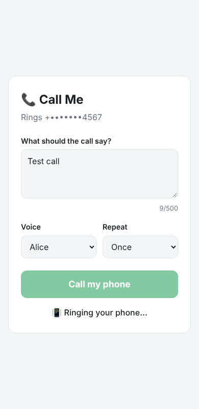

# 📞 Call Me

A tiny web app that calls **your own phone number**. Type a message, press **Call my phone**, and your phone rings and reads the message aloud. You can watch the call status live (ringing → connected → finished).



It uses Node's built-in HTTP server and the [Twilio](https://www.twilio.com) Voice API to place the call. The only dependency is the Anthropic SDK, used by the [personal assistant](#-personal-assistant-android-app).

## Setup

1. **Create a Twilio account** at https://www.twilio.com/try-twilio. The free trial includes credit.
2. **Get a Twilio phone number:** Console → *Phone Numbers → Manage → Buy a number* (trial accounts get one free).
3. **Trial accounts only:** verify your own phone under *Phone Numbers → Manage → Verified Caller IDs*. Trial accounts can only call verified numbers, and calls start with a short Twilio trial message.
4. **Configure the app:**
   ```bash
   cp .env.example .env
   ```
   Fill in `TWILIO_ACCOUNT_SID` and `TWILIO_AUTH_TOKEN` (shown on the Console home page), `TWILIO_FROM_NUMBER` (your Twilio number) and `MY_PHONE_NUMBER` (your phone). Write both numbers in E.164 format, for example `+15551234567`.
5. **Run it** (Node 22.9 or newer):
   ```bash
   npm install
   npm start
   ```
   Open http://localhost:3000.

## Options

| Setting | What it does |
|---|---|
| Message | Up to 500 characters, read aloud using text-to-speech. If left empty, a default greeting is used. |
| Voice | Alice, Woman or Man. |
| Repeat | Read the message 1–3 times. |
| `APP_PASSWORD` | When set, the page asks for this password before placing a call. Set it if you host the app anywhere public. |

## Safety

The app only ever dials `MY_PHONE_NUMBER` from your `.env` file. The browser can't choose the number to call, so the app can't be used to call other people. Your `.env` is git-ignored, so your credentials stay out of the repo.

## 🤖 Personal assistant (Android app)

Open **`/assistant`** for a chat assistant you can install on your phone's home screen. Type or tap 🎤 and talk. It answers directly, and can read its replies aloud.

It runs on Claude (`claude-opus-5-5`) and can:

- **Remember things.** "Remember my locker code is 4512." Notes are saved on the server in `data/notes.json` (git-ignored). Ask "what's my locker code?" later.
- **Read your calendar.** "What's on tomorrow?" or "Am I free Friday afternoon?" (read-only).
- **Search the web** for current facts such as news, weather or opening hours.
- **Ring your phone** with a message, using the Call Me feature. It only calls when you ask.

### Set it up

1. Get an API key at https://platform.claude.com and set `ANTHROPIC_API_KEY` in `.env`.
2. *(Optional)* Connect your calendar: set `CALENDAR_ICS_URL` to a private iCal link. In Google Calendar, go to *Settings → (your calendar) → Integrate calendar → Secret address in iCal format*. Set `TIME_ZONE` too, for example `America/Chicago`.
3. **Set `APP_PASSWORD`.** The assistant can read your notes and calendar, so protect it before putting it online.
4. Put the app on an **HTTPS** address your phone can reach. Android only installs apps and allows the microphone over HTTPS. Two options:
   - **Quick test:** run `npm start`, then in another terminal run `npx cloudflared tunnel --url http://localhost:3000`. It prints an `https://….trycloudflare.com` address.
   - **Always on:** deploy to [Railway](#deploy-to-railway) (config included), or any Node host with the same environment variables and a persistent disk for notes.
5. On your Android phone, open `https://<your address>/assistant` in **Chrome**. Tap **Install** in the header, or use *⋮ → Add to Home screen / Install app*. Enter your app password under ⚙︎.

It now opens full-screen like a normal app. The 🔈 button turns read-aloud on for every reply. Replies to spoken questions are always read aloud.

### Deploy to Railway

`railway.json` holds the deploy settings: it starts with `npm start`, uses `/api/config` as the health check, and restarts on failure.

1. On [railway.com](https://railway.com), choose **New Project → Deploy from GitHub repo** and pick this repository.
2. In the service's **Variables** tab, add `ANTHROPIC_API_KEY`, `APP_PASSWORD` and `TIME_ZONE`. Add the optional ones you use: `CALENDAR_ICS_URL`, `MY_PHONE_NUMBER`, the `TWILIO_*` settings and `AGENT_TOKEN`. Railway sets `PORT` itself.
3. **Attach a volume** to the service (any mount path, e.g. `/data`). Notes are saved there automatically. Without a volume they are lost on every redeploy.
4. Under **Settings → Networking**, generate a domain. Open `https://<domain>/assistant` on your phone.

## 🔊 Noise alerts (phone listens, computer gets notified)

Open **`/listen`** on your phone and tap **Start listening**. The page learns the room's normal sound level for a few seconds. When something is clearly louder, it sends an alert. Only the loudness number leaves the phone; no audio is recorded or uploaded.

**Set it up**

1. Pick a long, hard-to-guess topic name, for example `pollo-noise-7f3k9q2m`. Set it as `NTFY_TOPIC` on the server (Railway → Variables) and redeploy.
2. **On your computer:** open `https://ntfy.sh/<your topic>` in your browser and allow notifications. You can also install the free ntfy desktop or phone app from https://ntfy.sh and subscribe to the topic. Alerts pop up as notifications.
3. **On your phone:** open `https://<your server>/listen` in Chrome, enter your app password if asked, and tap **Start listening**. Tap **Send test alert** to check that your computer gets it.
4. Leave the phone **plugged in** with the page open. The page asks Android to keep the screen on. If the screen still turns off, turn on *Settings → Developer options → Stay awake* (while charging).

**Tuning:** *Alert when louder than normal by* sets the sensitivity (lower means more sensitive). *Wait between alerts* stops a noisy room from flooding you. The server also never sends two alerts less than 15 seconds apart.

**Jarvis or other apps:** set `JARVIS_WEBHOOK_URL`, and every alert is also POSTed there as JSON: `{"type":"noise","at":<epoch ms>,"level":<dB>,"over":<dB above normal>}`.

**Limits:** Android pauses web pages when you switch apps or lock the screen, so the page must stay on screen. Only use this to monitor your own space, and respect the privacy of anyone else nearby.

## 📞 Phone agent (call or text your assistant)

The companion repository `norma-739eb85f` holds a [Bland](https://www.bland.ai) phone agent. You call or text its number, and it answers using your notes and calendar from this server. It uses these endpoints:

| Endpoint | Does |
|---|---|
| `GET /api/agent/calendar?days=7` | Upcoming events |
| `POST /api/agent/notes/search` `{ "query": "..." }` | Search notes |
| `POST /api/agent/notes` `{ "text": "..." }` | Save a note |

Each request must send `Authorization: Bearer <AGENT_TOKEN>`. When `MY_PHONE_NUMBER` is set, the `X-Caller` header must also match it, so other callers can't read your data. If `AGENT_TOKEN` is unset, these endpoints are switched off.

To connect it:

1. Set `AGENT_TOKEN` in `.env` to a long random string.
2. In Bland, add a secret named `ASSISTANT_TOKEN` with the same value (*Dashboard → Tools → Secrets*).
3. Set the agent variable `ASSISTANT_URL` to this server's HTTPS address with no trailing slash, for example `https://my-assistant.onrender.com`. Set it in each environment you use (development, staging, production).

## API

- `GET /api/config`: shows whether the app is configured, with the target number masked.
- `POST /api/call`: places the call. Body: `{ "message": "...", "voice": "alice", "repeat": 1 }`.
- `GET /api/call/:sid`: returns the live call status.
- `POST /api/noise`: sends a noise alert. Body: `{ "level": -30, "over": 20 }` (dB). `GET /api/noise` lists recent alerts.
- `POST /api/assistant`: asks the assistant. Body: `{ "messages": [{ "role": "user", "content": "..." }, ...] }` with alternating user/assistant turns, ending on a user turn. Returns `{ "reply": "..." }`.

If `APP_PASSWORD` is set, send it in the `X-App-Password` header.
